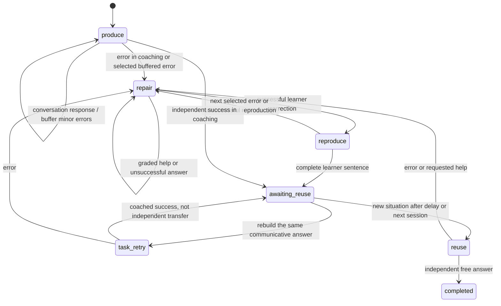

# English Coach

A separate Python package, loaded into GPT Saver's existing authenticated MCP
server. The admin UI is served by the existing host; no separate service, audio client or database. Requirements live in the
Obsidian English backlog, IDEA-004 with links to IDEA-001/002.

## Published cabinet

Cabinet: https://eng.moras.keenetic.pro (redirects to `/english`).
Release: Coach **0.9.0**, UI **0.4.0**, teaching policies **1.0.0**.
Nginx first requests the credentials configured in `admin-protect`.
The personal Saver login below is a separate second step.
The owner leaves the login field empty and uses the existing private Saver code.
Family members use their personal login/code. Codes are never included in Git.

The cabinet runs inside the existing `mcp-gpt-saver` Docker container at
`/opt/mcp-gpt-saver`, using its existing memory and auth stores. Nginx Proxy
Manager forwards this domain to `192.168.1.149:8765`, redirects `/` to `/english`,
and exposes only cabinet routes. HTTPS uses the domain's existing certificate.
`SAVER_ENGLISH_WEB_ORIGIN=https://eng.moras.keenetic.pro` enables this exact
browser origin. The original `SAVER_URL`, OAuth issuer and MCP resource stay at
`https://mcp-gpt-saver.moras.keenetic.pro`; existing ChatGPT connections remain valid.

Host source and deployment files: https://github.com/aalexmora/mcp-gpt-saver.
Keep both private repositories beside each other to build:

```sh
cd ../mcp-gpt-saver
./scripts/build-coach-wheel.sh
docker compose build saver
docker compose up -d --no-build saver
```

Before production changes, back up the existing memory/auth databases with the
host's `scripts/backup.py`, verify integrity/checksums, preserve private config
and retain the current Docker image. Do not publish backups, credentials or
learner exports. The host's `deploy/english-cabinet-nginx.conf` is the cabinet
Proxy Host's advanced configuration, paired with native Custom Locations in
`deploy/english-cabinet-locations.json` so NPM applies its Access List. The
original MCP host uses `deploy/english-mcp-domain-nginx.conf` to block cabinet
paths while preserving OAuth/MCP. Change the saved NPM host, not only its
generated file. `deploy/mcp-gpt-saver.service` restores this container after
Docker/network startup and retries while its configured address is unavailable.

Deployment verification covers HTTPS, private login, scoped reads, logout,
installed versions and the original MCP endpoint. Provider integration and real
lesson acceptance require separate checks; UI reads never start a model job.

## Multi-learner backend (Coach 0.8.0)

The production Saver host supports personal English OAuth accounts as of
2026-10-10. No family member account was created during rollout. The original
prototype still uses fixtures. The connected cabinet at `/english` uses
authorized host data; it has no demo fallback.

Use `list_english_learners` to discover permitted profiles. An English tool's
optional `learner_id` is authorized by the host before binding both MemoryAPI and
LegacyEnglishAPI. With one accessible profile the existing client remains
compatible. With several accessible profiles each call must select one explicitly.
An existing session ID never selects or changes its owner.

The administrator calls `create_english_learner` with a unique idempotency key and
display name. The response contains a private, one-use enrollment URL valid for
24 hours. Open it privately: the learner chooses their own access code and receives
their login. New learners have English scope only, empty history, and no inferred
goal or proficiency. Enrollment links and codes must not be stored in notes or
exports. `set_english_learner_access` requires a fresh account `expected_version`;
delegated access requires explicit agreement and `access_confirmed=true`.
Deactivation revokes OAuth grants and preserves history. Reactivation requires a
fresh login and does not restore revoked bearer tokens.

The existing owner's identity, IDs and export path remain intact. Other learners'
exports use `learners/<learner_id>/english` under Saver's export root. Accounts are
stored in the existing OAuth database; learning records stay in the existing
memory database. Each learner has a durable review queue; the host limits provider
calls to two at once and checks active access again before applying a result.

## Teaching policies (foundation/conversation 1.0.0)

`list_english_teaching_policies` reports the available policy versions and their
changes. Select `policy_id="foundation"` or `policy_id="conversation"` when calling
`configure_english`; existing clients keep the foundation policy. Both
policies are version 1.0.0. Each new session and review job retain their policy
snapshot. Changing future settings does not rewrite an active lesson or history.
Unknown saved policy versions fail explicitly before a provider call.

Foundation retains basic vocabulary, supported practice and homework in two
approaches totaling 10–15 minutes. Conversation uses natural teacher English,
brief corrections after the learner's thought and continued dialogue without
compulsory repetition. C1/B2 are teaching targets, not measured proficiency.
Conversation preparation is off by default; an explicitly agreed positive
`homework_minutes` setting enables optional opinion/story tasks for future lessons.

`set_english_grammar_permission` requires explicit `learner_confirmed=true`. Choose
`scope="future"` for future lessons or `scope="item"` with `session_id` and
`item_id` for one active conversation block. Use the current profile or session
`expected_version` respectively. Revoking permission stops the drill path and
preserves observations. Foundation is unaffected. Structured activity types and
obvious worksheet wording are checked; the teacher still reviews prompt meaning.
Conversational onboarding and topic planning are also implemented locally.

`get_english_conversation` proposes the initial topics and route without saving
preferences or inventing proficiency. Collect interests, situations, correction
preferences and agreed minutes one question at a time. Then call
`onboard_english_conversation` with `learner_confirmed=true`, the actual goal/load
and two or three comfortable topic IDs. `reported_level` retains its declared
source and `assessed=false`. The five communicative labels in the original host
pattern registry have no attempts until actual replies are saved.

Start with `start_coach_session` and explicitly `begin_item`. The route is
provisional during the introductory conversation. `select_english_conversation_topic`
supports planned/free/custom topics and returning to the planned topic, preserving
unfinished items. `set_english_conversation_topics` agrees additions/replacements
and skipped topics for future lessons. Current and carried topic context remains
frozen. After replies on at least two topics, `set_english_conversation_route`
agrees a flexible order of dialogue/story/opinion/comparison/spontaneous goals,
next topics and the observed rationale through profile CAS.

At an explicitly requested checkpoint, `save_english_conversation_block` saves
up to 20 actual replies through LegacyEnglishAPI and stores only evidence
references, demonstrated dimensions and teacher corrections in Coach documents.
Supply one annotation per `attempt_key`. Corrections distinguish actual errors
from natural alternatives and include the actual `occurred_at` time and reviewed
meaning; at most two focuses are allowed per topic block. Immediate imitation
stays assisted, including buffered replies within one checkpoint. Delayed reuse
requires a saved correction reference, a later independent correct reply and a
different situation. These annotations are teacher judgments, not measured CEFR.

`finalize_english_lesson` still requires explicit ending. It now freezes a
conversation summary containing references to independent examples, up to three
corrections and a next-topic proposal. Read original dated replies, assistance,
progress dimensions and that summary with `get_english_conversation`, optionally
by session and page. Future review snapshots include bounded conversation context;
the next lesson shows saved correction focuses to revisit naturally. Only text
conversation is supported; live pedagogical acceptance remains pending. The connected UI is implemented locally as described below.

## Connected cabinet (UI 0.4.0)

With `SAVER_ENGLISH_COACH=1`, the existing Saver host serves `/english`.
The browser uses a private eight-hour HttpOnly, SameSite=Strict session cookie
(Secure for an HTTPS host), independently of the model's authorization.
Log in with the existing personal Saver code and login; the owner's login is blank.
Logout, expiry, deactivation and credential rotation invalidate the browser session.
The existing account throttling and host request-size limit apply. Login and every
write check the exact host origin and CSRF; no bearer token or code is placed in
browser storage or URLs. Only the appearance preference uses localStorage.

Four primary pages and eight legacy API projections read public MemoryAPI and LegacyEnglishAPI in an atomic host
snapshot. Lists are paginated; aggregates cover all matching original observations,
with Moscow date boundaries and independent/hint/imitation evidence separated.
Vocabulary states and lifetime counts remain saved evidence, not a CEFR score.
The UI shows each recorded historical policy, future plan, source usage, review
findings and plan changes. Missing audio, usage accounting and unsaved provider
history remain unavailable. Refresh, period filters and bounded polling never
invoke a model or mutate learning history. The read-only MCP tool
`get_english_admin_view` exposes the same named projections with authorized
optional `learner_id`.

Settings, scoped grammar permission, review proposals/retry, source archive,
profile restoration, original-response feedback and explicit homework-key reveal
use named domain operations with current versions, an idempotency key and an
explicit preview/decision. There is no generic document/queue editor or manual
mastery control. An explicit review retry uses model capacity; a stale result is
not silently reapplied. Family provisioning uses private one-use enrollment links
and has no default administrator access to another learner's history.

This first connected cabinet reads homework and provides its ID for continuing
in the existing chat. It does not grade free text from a browser or reopen a
finished lesson for homework. Submission directly from the cabinet, live account
setup and pedagogical acceptance remain later work in the canonical backlog.

Run combined regression in the existing Saver environment:

```sh
.venv/bin/python -m pytest -q tests ../english-coach/tests --tb=short
```

The admin tests use temporary host storage and synthetic personal accounts. They
cover CSRF/session revocation, foreign-profile denial, all-section read purity,
full-list pagination, Moscow boundaries, CAS/idempotency, key exposure, retry,
proposal decisions, archive, restoration and feedback without replacing original
answers. The 2026-10-10 rollout retained verified database backups and a rollback
image. Deployment and model integration were checked separately; real teaching
acceptance remains open in IDEA-004.

## Local enablement

Coach **0.8.2** fixes the Voice version contract. Runtime and save receipts
return `session_version` for the original Saver session and `coach_version` for
the Coach document. `save_english_progress` and `save_checkpoint` accept
`expected_session_version` and optional `expected_coach_version`; omitting the
original session token resolves it inside the save transaction. Plan Guard uses
`expected_coach_version`. The deprecated `expected_version` input remains an alias
of the version historically used by that tool; contradictory aliases fail.

A failed CAS returns a compact `Version conflict` JSON payload with the object,
expected/current versions, saved position and retry fields. The failed command
commits nothing: retry once with the same idempotency key and observations after
correcting the session token. Changed Coach state needs inspection before retry.
`get_english_session_state` reads named versions and the saved cursor without
loading original observations or the full lesson plan. Save receipts include
`next_action` / `next_item`; optional explicit `completed_item_ids` atomically
advance performed blocks and require Coach CAS. Saving answers alone never
completes an item. The full context adds scheduled and curriculum suggestions.

`get_english_review(job_id)` now excludes the input snapshot by default and reports
status, result/error, applied profile version and whether that version remains
current. `detail="full"` retains the full job read. `queued` / `running` are
pending; `failed` / `stale` / `superseded` did not apply a plan. Applied reviews
update the future template while retaining the active lesson. This release
requires the sibling host's public `LegacyEnglishAPI.metadata` and updated MCP
checkpoint adapter. Production rollout on 2026-10-12 passed candidate MCP checks,
HTTPS/OAuth and scope isolation, a 59-tool public catalog and live cursor/review
reads. Original 347 observations and 13 sessions matched before/after; verified
backup and the 0.8.1 rollback image remain on the host. The ChatGPT English Coach
catalog was refreshed to 39 write / 20 read tools. A new real Voice lesson is a
separate acceptance check.

Use the existing sibling `mcp-gpt-saver` environment. From that project:

```sh
.venv/bin/pip install --no-deps -e ../english-coach
```

The install may fetch setuptools into an isolated build environment; application dependencies use the existing environment.

Set these variables in your local service environment (do not commit secrets):

```dotenv
SAVER_ENGLISH_COACH=1
COACH_PROVIDER=test
COACH_MODEL_TIMEOUT=30
COACH_MAX_ATTEMPTS=3
COACH_MAX_INPUT_OBSERVATIONS=40
```

Keep the existing `SAVER_DATA`, `SAVER_EXPORT`, `SAVER_URL`, and
`SAVER_LOGIN_HASH` configuration. For a local experiment use a **new data
directory** or a verified backup copy, never the running production volume.
Launch with the existing server command:

```sh
.venv/bin/python -m uvicorn saver.server:create_app --factory --host 127.0.0.1 --port 8000 --no-access-log
```

Refresh the client's MCP tool catalog. Existing `memory:english` grants suffice;
Kids and B2B grants cannot call Coach tools. Production was deployed on
2026-09-24 in GPT Saver image 0.2.0 with this package as wheel 0.1.0.
`COACH_PROVIDER=test` is a deterministic test double, not a live AI methodologist.
The default provider is `disabled`: saves are durable, but review jobs eventually
show `failed` until a provider is configured. No silent fake-provider fallback.

For a real provider set `COACH_PROVIDER=http`, `COACH_MODEL_URL` to a full HTTPS
chat-completions-compatible endpoint, `COACH_MODEL`, `COACH_API_KEY`, and optionally
`COACH_MAX_OUTPUT_TOKENS` (default 2500). Use `COACH_RESPONSE_FORMAT=json_schema`
for providers with strict Structured Outputs or `json_object` for JSON mode. The
adapter includes the full schema in the prompt and validates the response again
locally. As of 2026-10-10, production Coach 0.8.0 uses official Sign in with
ChatGPT authorization and `gpt-6-sol` through the public Responses API and the
existing host SOCKS proxy. The account's identity and plan-usage permission were
verified; its catalog includes the configured model. Synthetic review and
material calls passed on the deployed image. Saver health and the public
OAuth/MCP catalog passed with 58 tools. Live pedagogical acceptance remains open;
connection checks do not count as learner progress. Credentials remain outside code.

The implemented `COACH_PROVIDER=chatgpt` mode uses the official Sign in with
ChatGPT flow and the public `https://api.openai.com/v1/responses` endpoint.
It requires a separate English Coach registration authorized for
`chatgpt.tokens.use.direct` and `resource.invoke`. Hermes's existing Codex
identity-only credentials do not grant these permissions and are not imported.
Requests use `store=false`, `stream=true`, JSON Object output and the same
local review/evidence checks. Only `response.completed` is accepted; partial
or failed streams never produce an applied review. API-only output-token options
are omitted for this route; waiting and received output are bounded locally.

Complete the login on the computer running the browser, using the Saver
environment and a private credential path outside the source tree:

```sh
/path/to/mcp-gpt-saver/.venv/bin/python -m english_coach.chatgpt_auth --file /private/path/auth.json --host-id urn:uuid:YOUR_SAVED_VM_HOST_ID
```

The helper opens a loopback listener and prints an OpenAI authorization link.
The user selects their account and permits ChatGPT plan usage. It validates
PKCE/state/nonce and the ID-token signature, identity and granted scopes before
saving owner-only credentials. A declined plan permission keeps sign-in separate
from inference. Transfer the protected file over SSH to the self-hosted runtime,
preserve its stable host ID and let that runtime own subsequent rotating refreshes.
Set `COACH_AUTH_FILE` to its container path and `COACH_MODEL` to a model in that
account's catalog. The credential directory must support atomic replacement by
the service UID; concurrent renewals are serialized. Do not share Hermes's
renewable session. Production was activated after successful login and synthetic
review/material checks. See the official [sign-in guide](https://developers.openai.com/siwc/token-sharing-open-source/sign-in)
and [self-hosted guide](https://developers.openai.com/siwc/token-sharing-open-source/self-hosted-vms).

## Run and inspect a lesson

1. `get_english_context` in each new chat. If unconfigured, agree the goal,
   minutes, milestones and skill outcomes. `configure_english` requires explicit
   learner confirmation. Skills can link to existing `pattern_ids`; use the
   existing `add_pattern` for new topics. Legacy starter patterns remain available
   for review without forcing a past-tense curriculum.
2. `start_coach_session` starts or resumes. `start_session` remains compatible
   after configuration and returns the same session with Coach's authoritative
   plan. An existing active legacy session is adopted, retaining its unfinished
   tasks as opaque tasks, never converting summaries into scored observations.
3. `update_english_session(action="begin_item")` identifies the exercise actually
   used; submitted attempts then retain its mechanic version and settings. Without
   an explicit current item, attempts still persist but no mechanic attribution
   is invented. `complete_item`, `branch`, `return`, `pause`, `resume` are explicit
   transitions. Explain a detour and return to the remaining work.
4. Technical `save_checkpoint` does not call the model. An explicit user request
   to save progress uses `save_english_progress`; the receipt includes a review
   job ID and still-active session. Poll `get_english_review` for outcome.
5. `update_english_session(action="finish")` finishes only a completed plan or
   an explicit learner end (`explicit_end=true`). Remaining items carry forward;
   the original Saver scheduler advances from original completed-session evidence.
   Carried work is not silently truncated to the estimated time budget.
6. `set_english_settings` saves future preferences. `switch_english_mechanic`
   changes an unfinished current exercise and future preference. Preference is
   never evidence of effectiveness. `get_english_history` and `restore_english`
   restore plan/settings as a new version without deleting attempts.

There are two intentional version counters: `save_checkpoint` and
`save_english_progress` take the original **session.version**; plan transitions
and switches take **coach.version**. Configuration/settings/restore/proposal
approval take **profile.version**. Read fresh state after a conflict. Identical
retries reuse identical arguments and keys; new actions use new keys.

Goal example (replace with the learner's explicitly agreed goal):

```json
{"outcome":"Negotiate delivery plans at work","minutes":20,
 "milestones":["Clarify constraints","Offer alternatives"],
 "skills":[{"id":"clarify","outcome":"Ask a clarifying question","pattern_ids":[]},
           {"id":"negotiate","outcome":"Offer and justify an alternative","pattern_ids":[]}]}
```

## Persistence and review operations

Saver's public `MemoryAPI` is the same versioned document service exposed by
`get_memory_document`, `list_memory_documents`, `commit_memory` and `get_history`.
The in-process `atomic()` / `request()` API additionally composes document writes
with `LegacyEnglishAPI.checkpoint` in a single transaction. Neither Coach nor its
provider opens SQLite. The compatibility adapter owns original sessions,
attempts, patterns and interval computation; domain migration is intentionally
incremental. There is no remote call inside a SQLite transaction.

Schema v3 adds only the universal `documents` table. Old tables and IDs are
retained. New goals, plans, settings, session plan ledgers, discoveries and review
jobs are document values; Saver has no methodology rules. Managed document
namespaces are protected from generic MCP writes by the configurable
`SAVER_RESERVED_DOCUMENT_PREFIXES` policy (`coach-` by default). Do not remove
that reservation while using Coach. Generic memory clients must use the domain
tools for managed state, preserving its invariants.

Review input is immutable: profile version, Coach session version, original
session version, observed attempts and feedback. At most the latest 40 session
observations and 10 feedback items enter the model; input source counts disclose
truncation and the original full history stays in Saver. Skill counts derive
from original observations; evidence links are bounded. Less than three
independent observations is `insufficient_data`, not a level estimate.
Findings are hypotheses, not progress state. Assisted success cannot increase
the independent denominator.

`queued → running → applied | stale | failed`. A lease is timeout + 10 seconds;
after restart, a queued job runs and an expired running lease is recovered.
The default retry limit is 3 with bounded exponential backoff. Provider timeouts
and errors preserve observations and expose a sanitized error type. Invalid
results fail immediately. A renewed lease prevents an old worker from applying
a second result. Any changed input version makes the result `stale`; it is kept
for audit without changing current decisions. Request a fresh review explicitly
(use current session version, empty attempts, fresh request key) after a failure
or stale result; historical jobs are not edited or silently retried forever.

Automatic changes retain the agreed goal, task identities, skill associations,
completion ledger and workload ceiling. Goal/load changes remain proposals;
`decide_english_proposal` requires explicit confirmation and a current profile
version. It applies/rejects the exact proposal and records the user's decision.
Raw findings and rationales remain model output and require pedagogical judgment;
structural checks do not prove the quality of free text.

Discoveries are structured candidates supplied by the conversation agent, with
personal/general scope, skill, cue, context, evidence links, reuse trigger and
explicit-save flag. They are deduplicated by ID, scoped to the authorized owner,
ranked with explicit saves first, filtered by current skills and expire from
context after 90 days (history is retained). At most five cues enter context.
General scope does not publish personal material to other users or projects.
Automated audio extraction and cross-user discovery sharing are not implemented.

## Verification

From the sibling Saver directory, using its existing dependencies:

```sh
.venv/bin/pytest -q tests ../english-coach/tests
```

Tests use temporary data. The MCP test binds localhost, performs OAuth, uses the
official client for old/new tools, rejects premature finishing and managed-state
bypasses, restarts the actual process and checks persistence in a fresh chat.
Unit/integration tests cover atomic failure, retries, timeout, lease recovery,
double application, stale decisions, invalid model output, versioned mechanic
usage, rollback, discovery isolation and unchanged Kids/B2B behavior.
Pedagogical scenarios assert the action chosen for sparse evidence, repeated
errors, boredom, an explicit format request and hinted success. These are
contract checks against a deterministic provider, **not evidence that a live
LLM or learner improves**. The HTTP adapter is tested with a mock transport.

## Safe return to legacy behavior

1. Stop new saves; read pending jobs. Let them settle, or retain queued jobs for
   a later resume. Finish/pause handling must be deliberate: explicitly finish
   an active Coach lesson to write its unfinished carry-over before disabling.
2. Back up both memory and OAuth databases with Saver's existing backup command.
3. Set `SAVER_ENGLISH_COACH=0` and restart the **current schema-v3-compatible
   server**. Legacy tools, observations and scheduler work; Coach documents remain
   intact. Re-enabling adopts any current legacy lesson and reloads carry-over.
4. Do not run an old schema-v2 binary on a v3 database. For binary rollback,
   restore the paired pre-upgrade backup into a new directory. This returns to
   that point in time; retain the newer database to avoid losing later work.

Single process is the intended deployment; leases/CAS also guard against
accidental overlapping workers, but no distributed service architecture is added.

## Voice limitations

No audio/transcript access is added. Voice persistence exists only when the
client successfully calls a tool. If that mode cannot call MCP, load context
before voice and explicitly save the available summary/observations in text
later. Never promise background saving, exact timestamps, automatic extraction
from unheard audio or cross-mode context that the client has not verified.

Verification on 2026-09-24: **62 passed**, 2 existing Starlette/httpx deprecation
warnings. The production image passed isolated v2→v3 migration, a synthetic live
provider call, health/integrity checks and public OAuth/MCP isolation checks. The
active legacy lesson was adopted with zero new attempts and Future skills added.
Actual pedagogical quality and ChatGPT voice tool availability remain live checks.

## Speaking practice in package 0.2.0

Requirements and acceptance: Obsidian English **IDEA-006**, linked to IDEA-001/002/004.
This release adds `task_repetition`, `rapid_retrieval`, and `guided_transfer` (version 1)
alongside the three existing formats. No database migration is required. Existing
profiles/sessions load with absent new fields; old attempts and interval dates remain
unchanged. The 0.1.0 wheel is retained for rollback. Package 0.2.0 was deployed
on 2026-09-28; updating a learner's instructions alone does not install tools.

At lesson start, `get_english_context.methodology` identifies the running package
(`coach_version=0.2.0`), the methodology rules (`policy_revision=speaking-2026-09-28.1`)
and the current profile version. Announce these briefly before the first task.
The review snapshot also retains the package/policy versions. A profile change is
not a new policy release, and a policy version is not proof that a review ran.
On an older server without this field, say that the server does not report the
methodology version and announce only the returned profile version. Do not infer
a deployed version from this README or the user's saved instructions.

`coach-practice-<id>` documents hold the task, pattern link, conversation/coaching
mode, stage, help level, error buffer, pending repair references and original attempt
IDs. Suggested corrections are explicitly teacher interpretations. They do not add
observations. Original Saver attempts remain the only evidence ledger. Every response
and its practice transition commit atomically with request deduplication and version
checks. A practice change also changes the Coach session version, invalidating an older
methodologist snapshot. Technical practice saves never launch a model review.



Start/resume a session and `begin_item`, then `start_english_practice` with its Coach
version, one pattern linked to that item's agreed skill, and a short spoken task.
Use `mode=conversation` for uninterrupted role-play, otherwise `coaching`.
`update_english_practice` takes the practice version and original session version:

- `respond`: one actual learner observation. Produce/reuse are independent;
  repair and task_retry are hint-assisted; reproduce/full-model help are immediate_repeat.
  An ambiguous transcription persists but cannot advance the stage.
- `help`: one step through self-correction/retry, minimal cue, choice, full model.
  `coach`: select at most two buffered errors. The rest remain recorded for later.
- `repeat_task`: ask the learner to reconstruct the answer to the same task.
  `transfer`: a different situation after ten minutes (verified timestamp) or in the
  next session. Reuse requires independent free speech and a different context.

After a write, read `get_session` for fresh counters and `get_english_context` for
open practices plus original evidence. An explicit early finish carries plan items;
pending practice documents remain available for the next session. Begin the matching
skill item in the next session before continuing the practice. Don't mark an item
complete while its repair/reproduction is unfinished.

`speaking` in context is a derived projection: pattern evidence states, Error Harvest,
ranked queue and an opening of up to three relevant patterns. The opening is frozen
into each new session's `retrieval_opening`; use it **within** the existing time budget.
It prioritizes unfinished practice, recurring recent errors needing verification,
assisted-only recent performance and scheduled due items. It does not introduce a
second next_due scheduler. The old scheduler still runs at session finish.
Historical observed success and current need for practice are separate fields.
`automaticity=unmeasured`; no CEFR/mastery, latency or pronunciation score is invented.
Context bounds open practices to ten (total count supplied) and includes up to ten
original evidence records per practice. Additional managed documents can be read with
the existing public get/list memory tools; never mutate them through generic writes.

Examples of the intended spoken flow (illustrative, not live-model test evidence):

1. **Immediate answer → learner repair.** Previously: “Yesterday I meet…” → “Say met.”
   Now: “Yesterday you…? Try again.” → learner correction → “Say the whole sentence.”
   Later: “Tell your manager who you met and what you agreed.” Only that unprimed
   new-context answer is evidence of independent transfer.
2. **Constant corrections → role-play and focused coaching.** Customer: “The release
   is late. What happened?” Continue the customer's follow-up questions. Then “Two
   things to fix,” two repair loops, and “Explain it again to the customer.” This
   second telling is coached practice; a later manager scenario checks transfer.
3. **Rule recital → brief retrieval.** Instead of naming Future forms: “You have
   arranged a customer call for tomorrow. Tell your colleague.” One question, wait,
   then vary the situation. No stopwatch or pressure to answer faster than comfortable.

For local operation use the existing editable installation and `SAVER_ENGLISH_COACH=1`.
Build the deployment wheel from Saver with `sh scripts/build-coach-wheel.sh`; the
Dockerfile selects 0.2.0. Refresh the MCP catalog only after a server release.
To stop experimenting, restore the previous settings version via `restore_english`;
this preserves attempts and pending practice. In this learner's production profile,
version 3 predates this experiment; version 6 includes the lesson-continuation rule.
Before a package rollback, back up the databases and restore both plan and settings
to versions that use only roleplay/contrast/retrieval. Then use the previous wheel/image.
The old package cannot validate the new mechanic IDs. Keep all practice documents for
re-enabling; do not delete or overwrite the database.

Voice limitations remain unchanged: the client must actually execute a tool to save.
Without tools, keep only available conversation context and explicitly save in text
later; never fabricate earlier timestamps to claim delayed reuse. Real voice turn
detection, pronunciation and the pedagogical effectiveness of these formats remain
live checks, not outcomes established by the automated tests.

Local verification on 2026-09-28: **72 passed**, two pre-existing Starlette/httpx
deprecation warnings. This includes a real OAuth/TCP MCP speaking cycle across two
server restarts and the next lesson, atomic failure/deduplication, buffered coaching,
assistance guards, delayed evidence checks, stale review protection, settings rollback,
and unchanged legacy/Kids/B2B behavior. The production MCP catalog exposes the
two new practice tools, returns 0.2.0 methodology metadata and profile v6, and
passed OAuth project-isolation checks. A live teacher/voice lesson is still
needed to judge pedagogical behavior.

## Occasional work-meeting text (package 0.3.0)

On an explicit request, call `submit_english_material` once with a unique
`idempotency_key`, a 20–20000-character text excerpt and optional short `context`.
The server methodologist automatically selects at most five useful phrases or
communicative moves and saves them; the learner does not select cards. The receipt
reports saved phrases and duplicates. Identical retries use the same key and inputs.
No active lesson is required, and the call does not save attempts or run a progress
review. `get_english_context.work_material` returns up to five relevant recent
cards for occasional use within the existing plan. Exact source wording is marked
`quoted`; translated or improved wording is marked `adapted`.

The application stores selected cards and a source digest, not a separate copy of
the complete meeting excerpt. A selected quote can still contain exact source
wording. When `COACH_PROVIDER=http`, the submitted text is sent to the
configured external model provider. Provider failures save no cards and return a
sanitized error. The deterministic test provider is only a contract fixture; live
selection quality still needs evaluation during real lessons. On 2026-10-01,
package 0.3.0 was deployed in GPT Saver. An isolated synthetic excerpt passed
the live HTTP provider and saved three cards without attempts; the public OAuth
catalog exposed 35 tools, the service was healthy, and the ChatGPT English
Coach plugin catalog was refreshed. No synthetic meeting text was saved to the
learner's production profile.

## Work context in package 0.4.0

`submit_english_material` now returns a source ID and saves a bounded analysis:
topics, communicative situations, a quality explanation, selected phrases and
up to four work exercises. The complete input is not saved. In a later chat,
`get_english_context` ranks active sources against the current skill evidence,
returns `work_context` and `work_patterns`, and selects exercises in
`lesson_brief`. Repeated topics count submitted samples, not the frequency of
events in the learner's whole job. The original meeting is never a learner
attempt.

Choose a matching `lesson_brief.id` as `work_exercise_id` when starting a
practice. This links the practice to its source and records usage; the actual
learner answers remain only in Saver's original attempt ledger. The next
review receives those attempt IDs with the chosen exercise and can plan repair
or a later changed-situation check. `archive_english_material` excludes an
outdated source and its phrases from future lesson selection while retaining
versioned history. Read `work_context.version` and pass it as
`expected_version`.

At a lesson start, say the returned `say_first` as the first audible sentence.
It reports the installed Coach version, policy revision and profile version.
This is a server response contract; actual speech in a voice client requires
a client check. The local test provider is synthetic. Do not infer
pronunciation, pauses, speech rate or learning gains from transcript text.

## Curriculum and background review in package 0.5.0

`get_english_context` and each new review snapshot include the full versioned
`english-course-program` document from MemoryAPI. The model must attribute its
curriculum decision to the current stage and its sources. Source access limits
remain part of the input; this does not imply full textbook analysis. Changed
curriculum versions invalidate an in-flight review. Invalid curriculum blocks
review instead of silently applying an ungrounded decision. The worker does not
advance the course stage or certify mastery.

The Saver ASGI application lifespan owns the worker and exporter. Stateless MCP
request lifespans must not own them: closing a request would cancel provider work.
The TCP/OAuth regression uses a delayed provider and verifies completion with no
HTTP requests before restarting the service. Expired retry budgets retain the
last safe error category. Session usage settings are omitted from model snapshots
when redundant; the original session ledger remains intact.

Package 0.5.1 also checks evidence and uncertainty rules before accepting HTTP
provider output, with one bounded regeneration on a semantic violation. Only
fixed validation categories are exposed; rejected model text is not persisted.
The same validator protects the final atomic application of the decision.

## Compact lesson runtime in package 0.6.0

The public MCP `get_english_context()` now defaults to a bounded `lesson_runtime`
with one versioned next action, current curriculum stage, recent evidence,
verification tasks and guardrails. Request `detail="full"` for the original full
context and complete program. Internal `Coach.context()` retains its full default.
A runtime response over 24 KiB requests full loading rather than truncating rules.
Context reads never reconcile state by writing it. Template `pending` and session
`carried` are compatible; broken pointers require explicit recovery.

Recent metrics use up to 20 known results within 14 days and distinguish independent,
assisted and cold attempts. Historical delayed reuse and current verification need
are separate. These windows and the 10-minute practice guard are operational
heuristics, not mastery criteria. Completion of every plan item still requires an
explicit learner command to finish the lesson.

`check_english_teaching_turn` checks structured flags against saved attempt evidence
and the current Coach session version. It cannot verify unsubmitted speech or the
truth of declared meaning-preservation flags. `hands_free` requests short delivery;
`driving` defers tasks without changing the persisted lesson phase. The separate
`methodologist_health` distinguishes recovered service from historical failures.

Material extraction includes model-reported language review and preservation of
meaning. Uncertain/legacy items remain available in full context but are excluded
from runtime model-language selection. No existing source is deleted or silently
rewritten. Reviewed placeholders are rejected. Source-linked exercises retain their
communicative goal and delayed-transfer task. This gate is not human editorial QA.

Package 0.6.1 keeps an awaiting-reuse pointer compatible with an explicitly begun
next item; it still exposes conflicting active practice/item pointers with both
candidate items for deliberate recovery. Combined verification: 110 tests passed.


## Personal methodology management

The cabinet has four primary pages: home, methodology and agent instructions,
plan and progress, and methodologist decisions. Family access and theme settings
are secondary. Original evidence remains available through existing public APIs.

Named actions over MemoryAPI manage a personal persistent draft, deterministic
lesson illustration, future publication, one-session trial, explicit keep/return,
versioned restoration and methodology feedback. They use subject isolation,
idempotency keys and optimistic concurrency; they do not create attempts.
Active lessons retain their settings, goal and learning-instruction snapshots.
A stored or delivered instruction is not a verified teacher-behaviour claim.
Feedback answers are part of the strict review result and commit only with a
fresh input snapshot. Goal/load changes still require the learner's decision.

Authoritative requirements and acceptance remain in the linked Obsidian backlog.
